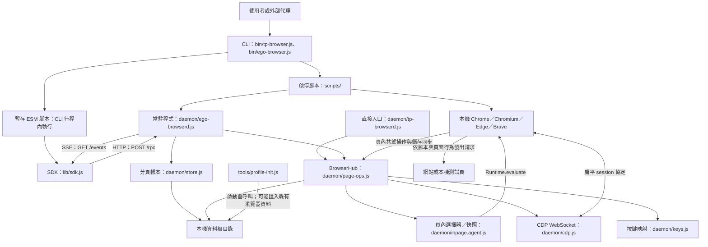

# tp-browser 架構

> 閱讀基準：本地提交 `f885545`，2026-10-31。以下描述已存在的程式行為，不將產品宣傳、歷史驗收或規劃視為本版實測結果。

相關文件：[路線圖](ROADMAP.md)、[操作手冊](RUNBOOK.md)。

## 定位與執行邊界

tp-browser 是本機瀏覽器自動化工具，由 Node.js CLI、HTTP 常駐程式、CDP 控制層與頁內 JavaScript 組成。它沒有 npm 執行期依賴，也沒有內建 LLM 推論服務；外部代理負責產生腳本，工具負責執行。

`nodejs` 子命令在 **CLI 自己的 Node.js 行程**執行輸入腳本，可使用 Node.js 檔案與行程 API，並非受限沙箱。`page.evaluate()` 才是在瀏覽器頁面脈絡執行。TaskSpace 是分頁帳本，不是獨立瀏覽器設定檔、Cookie 容器或使用者權限邊界。

單一 daemon 連接一個瀏覽器。預設通訊埠為 daemon `9772`、CDP `9773`；替代組為 `9774`、`9775`。兩組仍使用同一資料根目錄及設定檔，**不能據此推定可安全並行運作兩套實例**。

## 模組圖

圖中的兩個 daemon 共用底層模組，但入口檔案不是相同實作。

| 模組 | 責任與實際行為 |
|---|---|
| [package.json](../../package.json) | ESM 專案；宣告 Node.js `>=22` 與四個 CLI／daemon 名稱。未定義依賴、建置、測試或 lint 指令。 |
| [bin/tp-browser.js](../../bin/tp-browser.js)、[bin/ego-browser.js](../../bin/ego-browser.js) | 目前內容相同。解析生命週期命令、讀取本機連線資訊、建立 SDK 全域函式、執行輸入腳本。 |
| [lib/sdk.js](../../lib/sdk.js) | `TaskSpace`、`Page`、`Download`、`FileChooser`、滑鼠與鍵盤包裝；RPC 呼叫、SSE 等待及輪詢等待條件。 |
| [daemon/ego-browserd.js](../../daemon/ego-browserd.js)、[daemon/tp-browserd.js](../../daemon/tp-browserd.js) | HTTP 路由、認證、RPC 分派、TaskSpace 與分頁綁定、檔案路徑檢查、瀏覽器連線重試。 |
| [daemon/page-ops.js](../../daemon/page-ops.js) | `BrowserHub` 管理 target／session、導覽、CDP 動作、下載、對話框、共駕介面及登入狀態備存。 |
| [daemon/inpage.agent.js](../../daemon/inpage.agent.js) | 以文字注入頁面，建立 `window.__egoAgent`；處理 DOM 參照、選擇器、文字快照、編輯及上傳節點標記。 |
| [daemon/cdp.js](../../daemon/cdp.js) | 原生 WebSocket、請求 ID、等待中的 Promise、事件分派與逾時；使用 `sessionId` 路由分頁命令。 |
| [daemon/store.js](../../daemon/store.js) | JSON 分頁帳本；一般先寫暫存檔再重新命名，失敗時改為直接覆寫。沒有跨行程鎖。 |
| [daemon/keys.js](../../daemon/keys.js) | 快捷鍵剖析及 CDP 鍵碼；上層將 `ControlOrMeta` 依平台轉成 Control 或 Meta。 |
| [scripts/tp-start.sh](../../scripts/tp-start.sh)、[scripts/ego-start.ps1](../../scripts/ego-start.ps1) | 尋找瀏覽器、初始化設定檔、停止匹配的舊行程、啟動 daemon 與瀏覽器、輪詢健康狀態。 |
| [tools/profile-init.js](../../tools/profile-init.js) | 修改代理設定檔偏好，依候選瀏覽器的書籤數及資料量選來源，條件式複製書籤與登入相關資料。不是純空白設定檔初始化。 |
| [tests/](../../tests/)、[tests/bench/](../../tests/bench/) | 本機冒煙頁與十頁觀測資料量基準；不是自動啟動完整環境的測試框架。 |
| [docs/index.html](../index.html) | 靜態展示頁，可由 daemon 的 `/docs`、`/showcase` 讀取；不是獨立前端建置產物。 |

## 入口與安裝路徑的差異

| 呼叫來源 | 實際 daemon／安裝位置 |
|---|---|
| `tp-start`、`tp-browser start`，macOS／Linux | `tp-start.sh` 優先使用資料根下 `app/daemon/ego-browserd.js`，否則使用來源樹中的同名檔。 |
| Windows 啟動腳本 | 固定使用資料根下 `daemon/ego-browserd.js`。 |
| Unix 安裝後直接呼叫 `tp-browserd` 或 `ego-browserd` | 兩個包裝入口都執行 `app/daemon/tp-browserd.js`。 |
| `package.json` 宣告的 daemon 入口 | `tp-browserd` 與 `ego-browserd` 分別指向各自的檔案。 |
| 隨附 systemd 範本 | 使用 `app/daemon/ego-browserd.js`；瀏覽器路徑固定為 `/usr/bin/chromium`。 |

`ego-browserd.js` 比 `tp-browserd.js` 多了啟動時 `restoreVaultToBrowser()`、有頭模式最多恢復四個已保存 HTTPS 分頁、啟動後同步，以及 `/flush-and-close` 路由。兩者的 `BrowserHub` 本身都有週期性備存機制。

版本也尚未統一：套件宣告 `0.3.0`、CLI 顯示 `0.3.1`、內嵌新分頁顯示 `0.3.2`。除錯時應記錄提交 SHA 與入口，不能只報版本字串。

## 本機通訊介面

| 路徑 | 行為與檢查 |
|---|---|
| `POST /rpc` | 要求本機認證標頭；請求為 `{ id, method, params }`，回應為 `{ id, ok, result }` 或 `{ id, ok, error }`。本文上限 1 MiB，業務錯誤仍可能使用 HTTP 200，必須檢查 `ok`。 |
| `/events` | 要求本機認證標頭，提供 SSE 推播；訊息含 `type`、`targetId`、`kind`、`payload`。伺服器廣播，客戶端自行篩選，不是依 TaskSpace 隔離的頻道。 |
| `/health` | 不要求認證，回傳 daemon 與瀏覽器掛載狀態及空間數量；仍經 Host／Origin 檢查。 |
| `GET /newtab`、`GET /docs`、`GET /showcase` | 提供本機 HTML；路由位於 Host／Origin 檢查之前，不應概括宣稱所有路由都經同一驗證。 |
| `/flush-and-close` | 僅 `ego-browserd.js` 存在；經 Host／Origin 檢查，但未要求認證，即可觸發保存與瀏覽器關閉。不是健康探測端點，本次不呼叫。 |

一般控制路徑要求 Host 為 `127.0.0.1`（可含埠），拒絕帶 Origin 的請求；認證接受 `x-tp-token` 或 `x-ego-token`，比較使用 `timingSafeEqual`。SDK 使用後者，CLI 的部分直接 RPC 同時提供兩者。這是本機單一使用者控制介面，不是可直接對外公開的服務。

## 資料流

### 啟動與復原

1. 安裝器複製執行檔並產生包裝命令。Unix 使用 `~/.local/share/ego-linux/app/`；Windows 使用資料根下各模組目錄，另複製到 `~/ego-linux-install/`。
2. 啟動器建立目錄、選擇通訊埠及瀏覽器。需要重新啟動時，嘗試要求既有 daemon 保存並關閉瀏覽器，再以行程特徵清理、移除設定檔鎖並執行 `profile-init.js`。
3. daemon 建立本機認證檔、寫入 `daemon.json`、載入 `spaces.json`，在 loopback 提供 HTTP。
4. daemon 讀取 CDP `/json/version`，接受以 `ws://127.0.0.1:` 開頭的 WebSocket 位址。尚未就緒約每三秒重試；已連線後中斷則約兩秒後重連。
5. `BrowserHub` 啟用 target 探索，對非彈出視窗的頁面選擇性掛載；沒有使用瀏覽器層級 `Target.setAutoAttach`，以避免干擾 OAuth 彈窗。
6. 重新綁定只保留仍存在的 target；失效分頁會從帳本移除，空 TaskSpace 會被刪除。恢復瀏覽器分頁不代表恢復同一 TaskSpace 身分。

### 批次腳本與動作

1. CLI 從 `-e` 或標準輸入取得腳本，檢查 `/health`；`nodejs` 會在必要時自動呼叫啟動器。
2. CLI 將 SDK 函式放入全域，透過 `mkdtempSync()` 建立暫存目錄，寫入 `script.mjs` 後 `import()`。腳本不會整份傳給 daemon。
3. `taskSpace(name)` 先查列表，再使用既有空間或建立含 `p1` 的空間；daemon 將標籤綁到瀏覽器 target。
4. `Page` 方法轉成 `page.call`，攜帶 `spaceId`、`label`、方法及 JSON 可序列化參數。
5. daemon 找到 target，經 `BrowserHub` 發送 CDP；選擇器操作先注入頁內代理，再解析元素、捲動或發送輸入。
6. 回應沿 CDP → daemon → RPC → SDK 返回。腳本結束後 CLI 清除自己的暫存目錄並明確退出；未呼叫 `finish()` 的工作分頁不會因此自動關閉。

`evaluate(fn, arg)` 將函式轉成字串，在頁面呼叫時只傳入一個參數；不能直接使用 CLI 腳本閉包中的變數。選擇器支援 CSS、`@N`、`ref=N`、文字、角色、連結與 XPath 子集，不等於完整 Playwright 選擇器。

### 非同步事件與共駕

瀏覽器事件經 `BrowserHub` 分為彈窗、下載、對話框、選檔及共駕訊息。daemon 以 SSE 廣播給已認證客戶端；SDK 按 target 與種類配對等待者。下載另在 daemon 記憶體以 GUID 追蹤，完成後可查路徑或另存。

SSE 是首次等待時才建立的單一連線，沒有就緒握手、重播或自動重連。SDK 的 `waitForEvent()` 只支援彈窗與下載；對話框使用專用方法處理。不能把事件逾時一律解讀為網站沒有產生事件。

共駕膠囊及標題前綴是注入的頁內 UI，不是瀏覽器原生權限控制。`handOff()` 目前只更新狀態，`waitForControl()` 立即回傳；頁面 RPC 沒有依 ownership 阻擋操作。此外，共駕模式回呼使用尚未實作的 `Store.findByTargetId()`。**「人類接手」介面目前不能作為代理確實暫停的保證。**

### 檔案與登入狀態

- 上傳由 CDP 讀取 daemon 主機上的絕對路徑；截圖、`fetch` 另存及下載複製也在 daemon 端落檔。CLI 腳本自己的 `node:fs` 操作則不經 daemon 路徑檢查。
- `safePath()` 檢查絕對路徑、NUL 與 `..`，並對既存路徑／父目錄做真實路徑檢查。它沒有指定允許的根目錄，因此不能稱為「僅限工作區」的檔案沙箱。
- `BrowserHub` 約每四秒及載入事件後同步 Cookie；工作階段 Cookie 會被轉為約三十天有效期。HTTPS 頁面會將符合條件的 localStorage／sessionStorage 字串備存；缺少的值可於後續載入補回。
- Cookie 與網頁儲存備存以合併為主，沒有完整刪除同步；頁內變更偵測使用長度特徵，等長值異動可能漏掉。不可把備存視為一致性快照或可靠登出證明。
- `resetSiteAuth()` 會清除相符 Cookie、備存及目前來源的部分儲存；部分登入供應商會擴及一組相關網域，不是只影響當前分頁。操作後仍須驗證結果。

## 持久化位置與敏感性

資料根固定為 `~/.local/share/ego-linux/`；Windows 對應目前使用者家目錄。下表只記錄用途，不記錄任何檔案內容。

| 相對位置 | 用途／生命週期 |
|---|---|
| `token` | 本機 RPC／SSE 認證資料，由 daemon 首次建立；不得顯示、複製到文件或提交。 |
| `daemon.json` | 選用通訊埠、CDP 通訊埠、PID 與啟動時間；不是行程存活證明。 |
| `spaces.json` | 空間 ID、名稱、狀態、標籤及 target 綁定；不是瀏覽器設定檔備份。 |
| `profile-agent/` | 瀏覽器設定檔，可能包含匯入的登入資訊、Cookie、儲存及書籤。 |
| `cookies-vault.json`、`storage-vault.json` | 程式自行寫入的 JSON 登入狀態備存；未實作應用層加密。 |
| `session-tabs.json` | 最多八個符合條件的 HTTPS 網址及標題；可能含私人資訊。 |
| `cookies.json` | Cookie 匯出工具的預設輸出；包含登入態，非加密遷移封裝。 |
| `downloads/` | 瀏覽器下載落點；下載索引在記憶體，重啟後不保證仍能使用舊 `Download` 物件。 |
| `logs/daemon.log`、`logs/chrome.log` | Unix 啟動器的追加式輸出；Windows 啟動器雖建立 logs 目錄，沒有同樣的 stdout／stderr 重導向。 |

部分建立操作指定 `0700`／`0600`，Windows 安裝器另嘗試設定 ACL；這不代表所有既存檔案、另存檔案或安裝環境都已驗證權限。不要將整個資料根、快照、事件內容或日誌當成可公開的除錯附件。

## 外部相依

| 相依 | 必要性與邊界 |
|---|---|
| Node.js `>=22` | 必要；使用原生 ESM、`fetch`、WebSocket、HTTP、檔案、密碼學及子行程 API。以套件要求為準，不承諾 Node.js 20 相容。 |
| Chrome／Chromium／Edge／Brave | 必要；由作業系統另行安裝，必須支援遠端除錯 CDP。沒有內附瀏覽器下載器或驅動版本鎖定。 |
| macOS／Linux 工具 | 安裝／啟動腳本使用 POSIX shell、`curl`、行程查詢與一般檔案工具；遠端來源下載分支才使用 Git。 |
| Windows 工具 | PowerShell、CIM、`icacls`；有頭模式從 Session 0 切換時另使用工作排程器。需要可用的互動桌面才能實際人工操作。 |
| systemd 使用者服務 | Linux 選用路徑，不是必要依賴；範本有固定路徑，不應未核對就啟用。 |
| 網站與登入供應商 | 由腳本導覽或頁面自行連線；登入、網路、跨來源政策及反自動化限制由網站決定。沒有通用繞過保證。 |
| GitHub／外部產品連結 | 安裝器下載分支與展示頁連結使用；本地來源執行及離線程式檢查不需要聯網。 |

「零 npm 依賴」不等於沒有作業系統或瀏覽器相依。「本機保存 Cookie」也不等於執行任意腳本時不會對外傳送資料。

## 已確認的行為落差

| 現象 | 程式依據與影響 |
|---|---|
| 上傳節點標記不相容 | `inpage.agent.js` 的 `markForDom()` 產生 `egoid-…`，`page-ops.js` 卻要求 `/^ego-\d+$/`；標準 `setInputFiles()` 路徑會遭拒。 |
| `page.fetch()` 參數不相容 | `fetchIn()` 建立 `(url, opts)` 函式，`evaluate()` 卻把 `[url, opts]` 當單一參數傳入；不能宣稱文字或檔案下載已可正常使用。 |
| 關頁語意不同 | `TaskSpace.closePage()` 是 `release()` 別名，只解除綁定；實際關閉用 `Page.close()` 或 `finish({ keep: [] })`。 |
| 重新載入來源可能過時 | `reload` 使用帳本 `pg.url`，目前導覽路徑未同步更新該欄位，可能回到 `about:blank`。 |
| 部分保留與帳本不同步 | `finish({ keep: [...] })` 關閉其他 target，卻未同步移除那些標籤；後續操作可能遇到失效分頁。 |
| 冒煙測試不是發布閘 | 共 23 個檢查，但單純 `check(false)` 不設定非零退出碼；未涵蓋上傳、`page.fetch()`、共駕互斥或登入狀態復原。 |
| 安裝文件覆蓋不完整 | Unix 安裝器只複製 tests 的 `.mjs` 與 docs 的第一層檔案；Windows 安裝器未複製 docs、`package.json`、LICENSE、NOTICE。新增的本目錄不會由現行 Unix 複製命令遞迴安裝。 |

以上是原始碼及離線檢查可確認的現況；本次未改動執行程式。修正優先順序及驗收條件見[路線圖](ROADMAP.md)。
