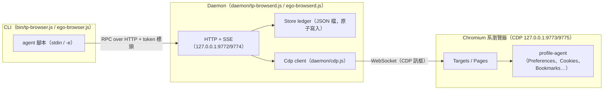

# tp-browser 資料模型文件（fmb-datamodel）

> 本目錄為**獨立新增**的資料模型文件，未修改任何既有檔案。
> 所有內容皆由 repo 內可見的原始碼靜態推導而得，**不含任何真實資料、憑證、Token、Cookie 內容或使用者資料**。
> 範例中的值一律使用 `FAKE_VALUE_FOR_TEST` 或顯而易見的佔位符。

## 文件地圖

| 文件 | 主題 |
|---|---|
| [`ledger-store.md`](./ledger-store.md) | TaskSpace ledger（`daemon/store.js`）的 JSON schema、欄位說明、空間／分頁狀態機 |
| [`runtime-files.md`](./runtime-files.md) | 執行期檔案（`token`、`daemon.json`）、埠位配置與檔案格式 |
| [`protocols.md`](./protocols.md) | Daemon HTTP/RPC 請求回應 schema、Health 端點、CDP WebSocket 線路格式與連線狀態機 |
| [`reaper.md`](./reaper.md) | `fmb_feature2/reaper.js` 的回收計畫結構、policy、分類器與狀態機 |
| [`input-structures.md`](./input-structures.md) | 按鍵描述元（`daemon/keys.js`）、benchmark 結果 JSON、瀏覽器 profile 檔案結構 |

## 系統資料流總覽

## 涵蓋範圍與限制

**已涵蓋**（依可見原始碼推導）：

- `daemon/store.js` — ledger schema 與 CRUD 行為
- `daemon/cdp.js` — CDP 線路訊息格式與連線生命週期
- `daemon/keys.js` — 按鍵名稱 → CDP 欄位的映射結構
- `fmb_feature2/reaper.js` / `cli.js` — 回收計畫所有輸入輸出結構
- `bin/ego-browser.js` — RPC 請求／回應外框、`daemon.json` / `token` 讀取行為
- `tools/profile-init.js` — profile-agent 內被讀寫的檔案與 Preferences 欄位
- `tests/bench/bench-run.ego.js` — benchmark 量測輸出 JSON 結構

**未涵蓋**（本次未提供這些檔案的內容，schema 僅能由呼叫端推測）：

- `daemon/ego-browserd.js` / `daemon/tp-browserd.js` 內部完整的路由表與錯誤碼枚舉
- `daemon/page-ops.js`、`daemon/inpage.agent.js` 的完整介面
- `lib/sdk.js` 的 SDK 方法簽名（僅知 `createClient({ port, token })` 與 `buildSdk({ rpc, waitPush })`，並將結果掛到 `globalThis`，含 `Page`、`TaskSpace`）
- `tools/cookies-export.ego.js` / `cookies-import.ego.js`（README 提及但不在檔案清單中，`cookies.json` 的確切 schema 未知）
- `docs/tp_win_ab_benchmark_results_1151018.json` 的完整欄位（僅依 `bench-run.ego.js` 的輸出結構記載）

## 慣例

- 「可選欄位」指原始碼中可能不出現或缺省的欄位；「常數」指寫入時固定、目前無其他值的欄位。
- 所有 ISO 8601 時間戳欄位皆為 UTC、`new Date().toISOString()` 格式（例：`2026-01-01T00:00:00.000Z`）。
- 本文件**不提供任何真實埠位上的實測資料**；埠號 9772/9773/9774/9775 為程式碼中的固定常數，非機密。
