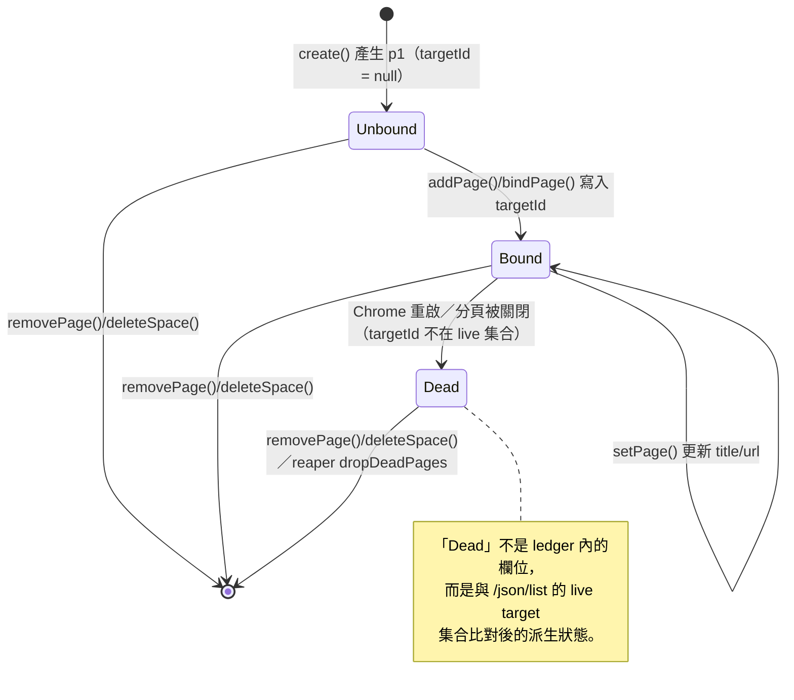
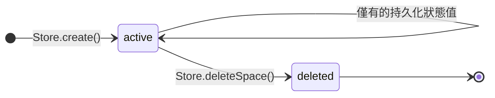
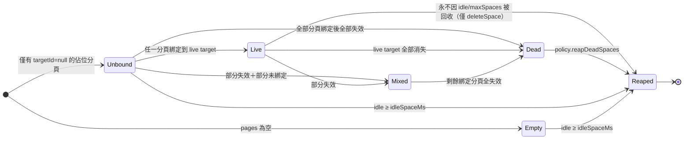

# TaskSpace Ledger 資料模型（`daemon/store.js`）

`Store` 是 daemon 的唯一持久化結構：一個 JSON 檔案，存放所有 TaskSpace（空間）與其分頁記錄。
寫入策略為**原子替換**：先寫 `${file}.${process.pid}.tmp`，再 `rename` 覆蓋正式檔；rename 失敗時 fallback 直接覆寫。

## 1. 最上層結構（Root Object）

```json
{
  "nextSpaceId": 1,
  "labelSeq": { "FAKE_VALUE_FOR_TEST": 1 },
  "spaces": { "FAKE_VALUE_FOR_TEST": { "...": "見 Space 物件" } }
}
```

| 欄位 | 型別 | 說明 |
|---|---|---|
| `nextSpaceId` | integer | 下一個空間 ID；`create()` 時取用後 **遞增（post-increment）**。單調成長，永不回收 |
| `labelSeq` | object&lt;string(spaceId) → integer&gt; | 每個空間的分頁標籤流水號；`nextLabel(spaceId)` 先 +1 再產生 `p{N}` |
| `spaces` | object&lt;string(spaceId) → [Space](#2-space-物件)&gt; | 以空間 ID（字串鍵）為索引的空間集合 |

注意：

- 檔案不存在或解析失敗時，daemon 會**靜默重建**初始結構（log 至 stderr），不視為致命錯誤。
- `nextSpaceId` 從 1 開始；第一個空間 id 為 1。
- `labelSeq[spaceId]` 初始為 1；第一次 `nextLabel()` 會把它變成 2 並回傳 `"p2"`（`p1` 於 `create()` 時直接佔用）。

## 2. Space 物件

由 `Store.create({ name, profileId })` 產生：

```json
{
  "id": 1,
  "name": "FAKE_VALUE_FOR_TEST",
  "profileId": "agent",
  "ownership": "agent",
  "state": "active",
  "createdAt": "2026-01-01T00:00:00.000Z",
  "pages": { "p1": { "targetId": null, "openedBy": "agent", "title": "", "url": "" } },
  "activeTargetId": null
}
```

| 欄位 | 型別 | 寫入者 | 說明 |
|---|---|---|---|
| `id` | integer | `create()` | 空間唯一 ID，來自 `nextSpaceId`；同時作為 `spaces` 的字串鍵與 `labelSeq` 的鍵 |
| `name` | string | `create()` 參數 | 呼叫端自訂名稱（如 `taskSpace("...")` 的引數） |
| `profileId` | string | `create()` 參數（預設 `"agent"`） | 關聯的瀏覽器 profile 識別碼；目前僅觀察到預設值 |
| `ownership` | string（常數 `"agent"`） | `create()` | 擁有者標記；目前程式碼只寫入 `"agent"` |
| `state` | string（常數 `"active"`） | `create()` | 空間狀態；目前程式碼只寫入 `"active"`，無其他轉移路徑 |
| `createdAt` | string（ISO 8601 UTC） | `create()` | 建立時間；reaper 以此作為閒置判定基準（無 `lastUsedAt` 欄位） |
| `pages` | object&lt;label → [Page](#3-page-物件)&gt; | 多個方法 | 分頁記錄集合，鍵為 `p1`、`p2`… |
| `activeTargetId` | string \| null | （`create()` 寫入 `null`） | 目前活躍 CDP target；`Store` 本身沒有更新它的 API（daemon 端負責） |
| `pinned` | boolean（可選） | **非 `Store` 寫入** | 僅 `fmb_feature2/reaper.js` 讀取的保護旗標；ledger 現行程式碼不會產生此欄位，屬外部延伸約定 |

## 3. Page 物件

```json
{
  "targetId": "FAKE_VALUE_FOR_TEST",
  "openedBy": "agent",
  "title": "FAKE_VALUE_FOR_TEST",
  "url": "FAKE_VALUE_FOR_TEST"
}
```

| 欄位 | 型別 | 說明 |
|---|---|---|
| `targetId` | string \| null | 綁定的 CDP target ID。`null` 表示「未綁定的佔位分頁」（`create()` 的初始 `p1`） |
| `openedBy` | string | 開啟者；可見程式碼中預設值為 `"agent"` |
| `title` | string | 分頁標題快照；初始為空字串，由 `setPage()` 補丁更新 |
| `url` | string | 分頁 URL 快照；初始為空字串，由 `setPage()` 補丁更新 |

`setPage(spaceId, label, patch)` 使用 `Object.assign` 淺合併，**任何**符合 Page 形狀的欄位都可被覆寫，沒有欄位白名單。

## 4. Store API 與其對 ledger 的影響

| 方法 | 對 ledger 的變更 | 備註 |
|---|---|---|
| `create({ name, profileId })` | 新增 `spaces[id]`（含佔位 `p1`）、`labelSeq[id]=1`、`nextSpaceId++` | 永遠建立 `p1: { targetId: null }` |
| `nextLabel(spaceId)` | `labelSeq[spaceId]++` | 回傳 `` `p${seq}` ``；空間不存在回傳 `"p?"` 且不持久化 |
| `setPage(spaceId, label, patch)` | 淺補丁 `pages[label]` | 空間或分頁不存在時靜默 no-op |
| `bindPage(spaceId, label, targetId, openedBy)` | **整顆覆寫** `pages[label]`（title/url 清空） | 空間不存在丟 `unknown space` |
| `addPage(spaceId, label, targetId, openedBy)` | **整顆覆寫** `pages[label]` | 與 `bindPage` 在可見程式碼中行為相同 |
| `removePage(spaceId, label)` | 刪除 `pages[label]` | 空間不存在時靜默 no-op；冪等 |
| `deleteSpace(id)` | 刪除 `spaces[id]`（**不**清 `labelSeq[id]**，也不回收 id） | 冪等；`labelSeq` 與 `nextSpaceId` 只增不減 |

所有寫入方法皆在最後呼叫 `persist()` → 整份 JSON 重寫。

## 5. 實體關係圖

```mermaid
erDiagram
  ROOT ||--|| SEQ "nextSpaceId"
  ROOT ||--|{ LABELSEQ "labelSeq（spaceId → 流水號）"
  ROOT ||--|{ SPACE "spaces（spaceId → Space）"
  SPACE ||--|{ PAGE "pages（label → Page）"
  SPACE {
    int id PK
    string name
    string profileId
    string ownership "常數 agent"
    string state "常數 active"
    string createdAt "ISO 8601"
    string activeTargetId "nullable"
    bool pinned "可選，外部延伸"
  }
  PAGE {
    string targetId "nullable，CDP target"
    string openedBy
    string title
    string url
  }
  LABELSEQ {
    string spaceId PK
    int seq
  }
```

## 6. Page 狀態機（以 `targetId` 為軸）

`Store` 本身不維護頁面狀態欄位；以下狀態由 `targetId` 的值與 CDP live 集合隱含推導（`fmb_feature2/reaper.js` 的 `classifySpace` 即依此分類）。



## 7. Space 狀態機

`Store` 寫入的 `state` 欄位只有 `"active"` 一值；下圖包含 reaper 派生的分類狀態（`kind`），兩者是不同層次的東西。



### reaper 派生分類（`kind`）轉移



## 8. 已知資料模型債

- **只增不減**：`labelSeq` 與被刪空間的殘留流水號、失效 `targetId` 記錄都會累積（`fmb_feature2` 的 reaper 即為此設計）。
- **無 `lastUsedAt`**：閒置判定只能用 `createdAt`。
- **無欄位白名單**：`setPage` 的補丁可寫入任意鍵，schema 靠呼叫端自律。
- **無並發鎖**：多個 daemon 共用同一 ledger 檔時，`rename` 原子寫只保證單檔一致，不保證跨程序讀寫序（見 `docs/fmb-security/CHECKLIST.md`）。
