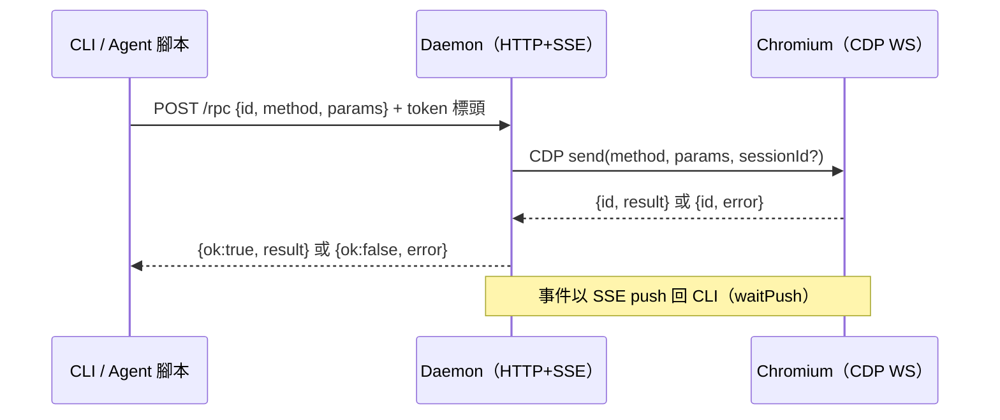
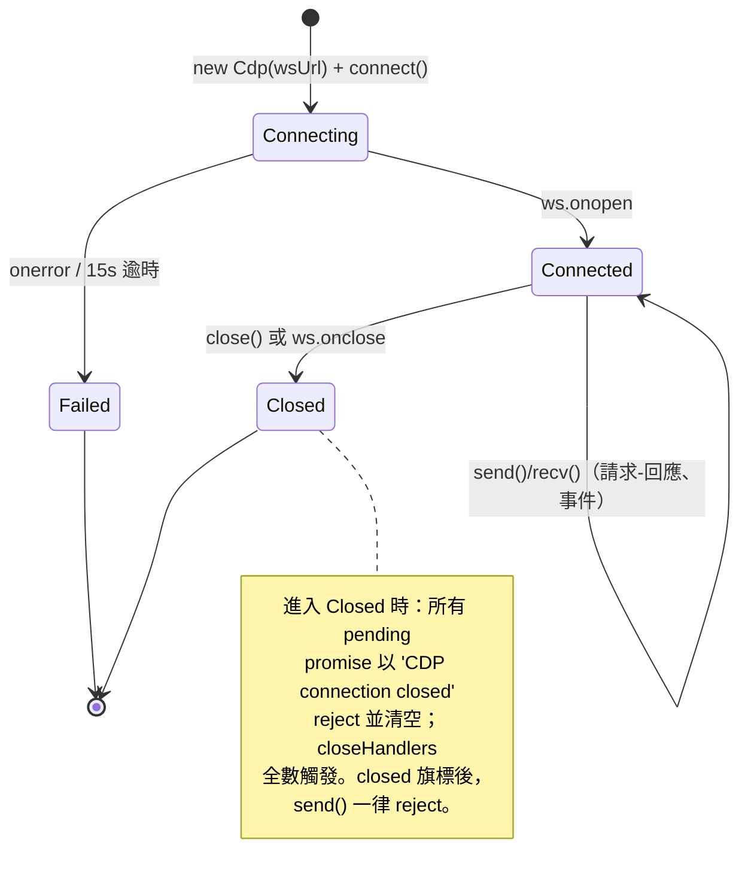

# 通訊協定資料結構

## 1. Daemon HTTP / RPC（`bin/ego-browser.js` 呼叫端視角）

### 1.1 請求

```
POST /rpc
content-type: application/json
x-tp-token: FAKE_VALUE_FOR_TEST
x-ego-token: FAKE_VALUE_FOR_TEST
```

```json
{ "id": 1, "method": "space.list", "params": {} }
```

| 欄位 | 型別 | 說明 |
|---|---|---|
| `id` | integer | 請求序號；CLI 端固定送 `1`（回應綁定由 daemon 端處理） |
| `method` | string | RPC 方法名。可見的方法：`space.list`；其餘方法（如分頁操作）由 `lib/sdk.js`／daemon 定義（本次未提供內容） |
| `params` | object | 方法參數，預設 `{}` |

### 1.2 回應

成功：

```json
{ "ok": true, "result": { "FAKE_VALUE_FOR_TEST": true } }
```

失敗：

```json
{ "ok": false, "error": { "name": "FAKE_VALUE_FOR_TEST", "message": "FAKE_VALUE_FOR_TEST" } }
```

| 欄位 | 型別 | 說明 |
|---|---|---|
| `ok` | boolean | 成功旗標 |
| `result` | any | 僅 `ok: true` 時存在；形狀依 method 而定 |
| `error.name` | string | 錯誤名稱（例如 CDP `CdpError` 的 `name`） |
| `error.message` | string | 人類可讀訊息 |

### 1.3 Health 端點

```
GET /health
```

```json
{ "ok": true, "chrome": true }
```

| 欄位 | 型別 | 說明 |
|---|---|---|
| `ok` | boolean | daemon 本身健康 |
| `chrome` | boolean | 是否已附接上 Chromium CDP（未附接時 daemon 會每 3 秒重試） |

### 1.4 其他可見端點

| 端點 | 用途 |
|---|---|
| `GET /newtab` | 有頭模式啟動時的初始頁 URL |
| `POST /flush-and-close`（以 curl 呼叫，max-time 3s） | 停止前沖刷 Cookie/storage 並優雅關閉瀏覽器 |

### 1.5 訊息時序



## 2. CDP WebSocket 線路格式（`daemon/cdp.js`）

Node 22 原生 `WebSocket`，flat session protocol。三種訊框：

### 2.1 請求（daemon → Chrome）

```json
{ "id": 1, "method": "FAKE_VALUE_FOR_TEST", "params": {}, "sessionId": "FAKE_VALUE_FOR_TEST" }
```

| 欄位 | 型別 | 必填 | 說明 |
|---|---|---|---|
| `id` | integer | ✔ | 本連線內單調遞增（`++this.id`），回應配對鍵 |
| `method` | string | ✔ | CDP 方法名 |
| `params` | object | — | 預設 `{}` |
| `sessionId` | string | — | 有值時走 flat session（綁定到特定 target 的 session） |

### 2.2 回應（Chrome → daemon）

```json
{ "id": 1, "result": {} }
```
或
```json
{ "id": 1, "error": { "code": -32000, "message": "FAKE_VALUE_FOR_TEST" } }
```

- `id` 對應 pending map 中的 promise；錯誤時 reject 為 `CdpError`（`error.cdpError` 保存原始 error object）。
- 逾時（預設 30,000ms／請求）會將 pending 移除並 reject。

### 2.3 事件（Chrome → daemon）

```json
{ "sessionId": "FAKE_VALUE_FOR_TEST", "method": "FAKE_VALUE_FOR_TEST", "params": {} }
```

| 欄位 | 型別 | 說明 |
|---|---|---|
| `sessionId` | string \| null | 首次出現的 sessionId 會被加入 `sessions` 集合 |
| `method` | string | 事件名 |
| `params` | object | 預設 `{}` |

handler 收到的事件統一形狀：`{ sessionId: string|null, method, params }`；單一 handler 丟例外只 log，不會中斷其他 handler。

### 2.4 逾時常數

| 常數 | 值 | 說明 |
|---|---|---|
| connect timeout | 15,000 ms | `connect()` |
| send timeout（預設） | 30,000 ms | 每個請求可覆寫 |
| `once()` 事件等待（預設） | 30,000 ms | 等待特定 method 的事件 |

### 2.5 Cdp 連線狀態機



### 2.6 CdpError 結構

| 屬性 | 型別 | 說明 |
|---|---|---|
| `name` | string | `"CdpError"` |
| `message` | string | `` `${method}: ${error.message}` ``（無 message 時 JSON.stringify 整個 error） |
| `cdpError` | object | 原始 CDP error object |

## 3. Agent 腳本執行模型（`tp-browser nodejs`）

- 腳本來源**只有** `-e` 引數或 stdin（heredoc）；一律先剝除 UTF-8 BOM。
- 寫入 `mkdtempSync(tmpdir())` 下的暫存 `script.mjs`（mode `0600`），以 `pathToFileURL` 動態 import，結束後 `rmSync` 清除。
- SDK 注入：`createClient({ port, token })` → `{ rpc, waitPush }` → `buildSdk({ rpc, waitPush })` 的所有函式／類別掛到 `globalThis`，並保證 `Page`、`TaskSpace` 全域可用。
- SSE 事件流會讓 event loop 活著，因此成功／失敗都**顯式 `process.exit(0|1)`**。
- 可見的 SDK 使用面（來自 `tests/` 與 `skills/` 引用）：`taskSpace(name)` 回傳帶 `page(label)` 與 `finish({ keep })` 的 task 物件；`page` 提供 `goto(url, { waitUntil, timeout })`、`snapshot({ scope })`、`screenshot({ path })`、`evaluate(fn)` 等。完整簽名在 `lib/sdk.js`（本次未提供內容）。
