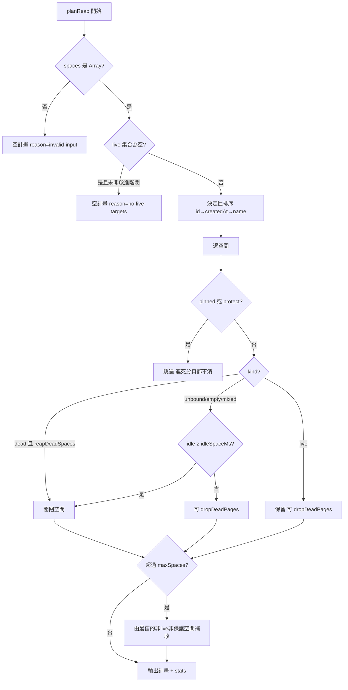

# Reaper（`fmb_feature2/reaper.js`）資料結構

Reaper 是純邏輯模組：吃 ledger 快照與 live target 集合，**產出回收計畫**，不做任何 I/O。結構上分四層：Policy（輸入）→ 分類結果 → 回收計畫 → 套用結果。

## 1. Policy（`DEFAULT_POLICY`，可部分覆寫）

| 欄位 | 型別 | 預設 | 說明 |
|---|---|---|---|
| `idleSpaceMs` | number (ms) | `1_800_000`（30 分鐘） | 空間完全無存活分頁且閒置超過此值 → 可回收 |
| `maxSpaces` | number \| null | `50` | ledger 空間數上限；`null`/`NaN` 表示不設限 |
| `reapDeadSpaces` | boolean | `true` | 所有已綁定分頁皆失效的空間，立即回收（不看閒置） |
| `dropDeadPages` | boolean | `true` | 丟棄「已失效但空間保留」的分頁記錄（含存活空間內的死分頁） |
| `reapIdleWhenNoLiveTargets` | boolean | `false` | live 集合為空時是否仍照閒置規則回收（安全閥，預設關閉） |

覆寫規則：傳入 plain object 時，僅 `undefined` 以外的鍵覆蓋預設；非物件輸入視為不覆蓋。

## 2. `classifySpace(space, { liveTargets, now, policy })` 輸出

```json
{
  "kind": "live",
  "ageMs": 1800000,
  "idle": true,
  "entries": [{ "label": "p1", "page": {}, "targetId": "FAKE_VALUE_FOR_TEST" }],
  "livePages": [],
  "deadPages": [],
  "unboundPages": []
}
```

| 欄位 | 型別 | 說明 |
|---|---|---|
| `kind` | `"live" \| "dead" \| "unbound" \| "mixed" \| "empty"` | 分類結果（見下表） |
| `ageMs` | number \| `null` | `now - createdAt`（下限 0）；`createdAt` 無法解析時為 `null`（不判定閒置） |
| `idle` | boolean | `ageMs !== null && ageMs >= idleSpaceMs` |
| `entries` | Array&lt;`{ label, page, targetId }`&gt; | 攤平後的分頁（`page` 非 plain object 者剔除；空/非字串 targetId 正規化為 `null`） |
| `livePages` / `deadPages` / `unboundPages` | Array | 依 live 集合過濾的子集 |

### `kind` 判定優先序

| 優先序 | 條件 | kind |
|---|---|---|
| 1 | 任一已綁定分頁在 live 集合 | `live` |
| 2 | `pages` 為空（或全被剔除） | `empty` |
| 3 | 所有分頁都已綁定且全部失效 | `dead` |
| 4 | 所有分頁都未綁定 | `unbound` |
| 5 | 其餘（部分失效＋部分未綁定） | `mixed` |

## 3. `planReap({ spaces, liveTargetIds, now, policy, protect })` 輸出

```json
{
  "closeSpaces": [2],
  "dropPages": [{ "spaceId": 1, "label": "p2", "targetId": "FAKE_VALUE_FOR_TEST" }],
  "staleActiveTargets": [{ "spaceId": 3, "targetId": "FAKE_VALUE_FOR_TEST" }],
  "reason": "no-live-targets",
  "stats": { "examined": 3, "skipped": 0, "live": 1, "protected": 1, "closed": 1, "pagesDropped": 1, "staleActiveTargets": 1, "overCap": 0 }
}
```

| 欄位 | 型別 | 說明 |
|---|---|---|
| `closeSpaces` | Array&lt;spaceId&gt; | 建議整空間刪除的 ID，**依 id → createdAt → name 決定性排序** |
| `dropPages` | Array&lt;`{ spaceId, label, targetId }`&gt; | 建議丟棄的死分頁（已關閉空間內的分頁會被剔除，不重複） |
| `staleActiveTargets` | Array&lt;`{ spaceId, targetId }`&gt; | **唯讀診斷**：未關閉、未受保護空間中 `activeTargetId` 已失效者；不會被自動清理 |
| `reason` | `"no-live-targets" \| "invalid-input"` | 僅在安全閥／非法輸入路徑出現；正常計畫無此鍵 |
| `stats` | object | 計數器（下表） |

### `stats` 欄位

| 欄位 | 說明 |
|---|---|
| `examined` | 通過形狀檢查（plain object 且 `id` 非 null/undefined）的空間數 |
| `skipped` | 被剔除的非法空間記錄數 |
| `live` | 分類為 live 且未受保護的空間數 |
| `protected` | `pinned === true` 或列入 `protect` 的空間數（**連死分頁都不清**） |
| `closed` | `closeSpaces.length` |
| `pagesDropped` | `dropPages.length`（過濾後） |
| `staleActiveTargets` | 診斷筆數 |
| `overCap` | 因 `maxSpaces` 上限被多關的空間數（只犧牲非存活、非受保護者，由最舊開始） |

### 安全閥

1. `liveTargetIds` 正規化後為空集合且 `reapIdleWhenNoLiveTargets !== true` → 回傳空計畫 + `reason: "no-live-targets"`（防 daemon 未接上 Chrome 時誤清整份 ledger）。
2. `spaces` 非 Array → 空計畫 + `reason: "invalid-input"`。
3. `createdAt` 無法解析 → `ageMs: null`，永不因閒置被回收（寧漏收不誤刪）。

## 4. `applyReapPlan(store, plan)` 輸出

```json
{ "closedSpaces": [2], "droppedPages": [{ "spaceId": 1, "label": "p2", "targetId": "FAKE_VALUE_FOR_TEST" }] }
```

- 透過既有 `store.deleteSpace(id)` / `store.removePage(spaceId, label)` 套用；方法不存在時安全 no-op。
- `closeKeys` 中的空間不再逐一刪分頁。
- `droppedPages` 項目需為 plain object 且 `label` 非 null/undefined。

## 5. 乾跑 CLI（`fmb_feature2/cli.js`）的輸入輸出

stdin（JSON）：

```json
{
  "spaces": [],
  "liveTargetIds": ["FAKE_VALUE_FOR_TEST"],
  "now": 1767225600000,
  "policy": {},
  "protect": []
}
```

| 欄位 | 必填 | 型別 | 說明 |
|---|---|---|---|
| `spaces` | ✔ | Array | ledger 空間快照（如 `store.list()` 輸出） |
| `liveTargetIds` | ✔ | Array&lt;string&gt; | Chrome `/json/list` 中 `type === "page"` 的 `id`，或 `Target.getTargets` 結果 |
| `now` | — | number (ms) | 蓋掉 `Date.now()` 以重現測試 |
| `policy` | — | object | 部分 policy 覆寫 |
| `protect` | — | Array&lt;spaceId&gt;（可為單值） | 額外保護清單 |

stdout：`planReap` 結果（`JSON.stringify(..., null, 1)`）。退出碼：`0` 成功、`2` 空 stdin 或非法 JSON。

## 6. 回收決策流程圖


